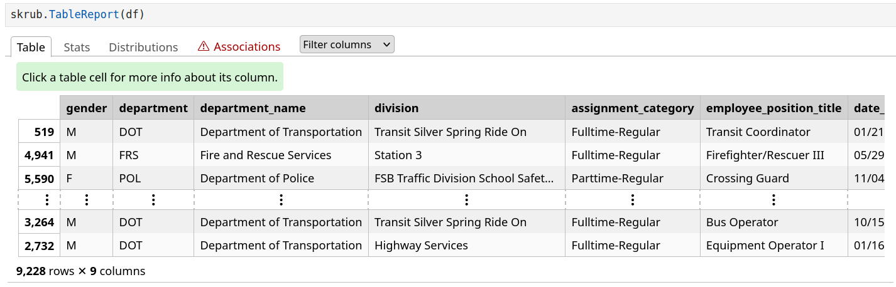
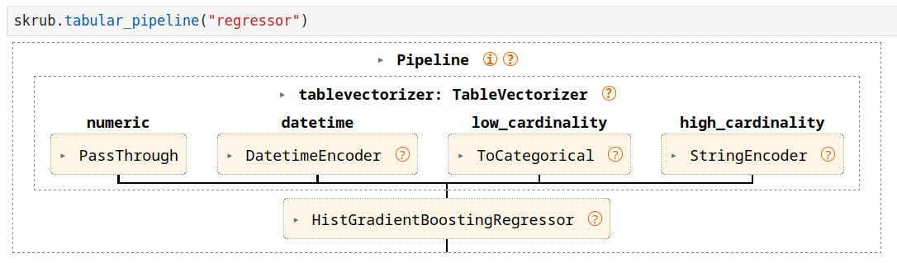
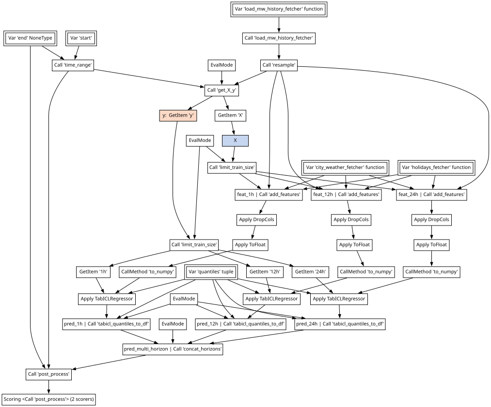
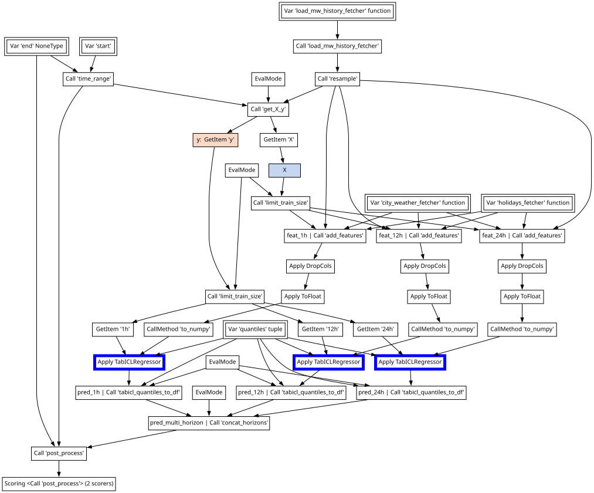
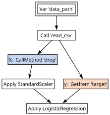

## Skrub {.smaller}

Machine learning on tabular data

{width="70%" style="margin-bottom: -1rem;"}

{width="60%" style="margin-bottom: -1rem;"}

::: {.incremental}
- [skrub-data.org](https://skrub-data.org)
- This talk: the [skrub DataOps](https://skrub-data.org/stable/data_ops.html) framework.
:::


## {.smaller}

:::: {.columns}

::: {.column width="44%"}

**Textbook ML**


<br>

$X \in \mathbb{R}^{n \times p},\ y \in \mathbb{R}^n$

$\hat{y} = f_{\hat{\theta}}(X)$

<br>

::: {.fragment}


```{=html}
<pre><code class="language-python">estimator = <span style="outline: 3px transparent; outline-offset: 1px;">TabICLRegressor()</span>

cross_validate(estimator, X, y)

estimator.fit(X_train, y_train)
estimator.predict(X_new)</code></pre>
```

:::


:::

::: {.column width="55%"}


::: {.fragment}

**Data-Science Practice**



:::


:::

::::

## {.smaller}

:::: {.columns}

::: {.column width="44%"}

**Textbook ML**

<br>

$X \in \mathbb{R}^{n \times p},\ y \in \mathbb{R}^n$

$\hat{y} = f_{\hat{\theta}}(X)$

<br>

```{=html}
<pre><code class="language-python">estimator = TabICLRegressor()

cross_validate(estimator, <span style="outline: 3px solid #2a52a8; outline-offset: 1px;">X</span>, <span style="outline: 3px solid #c04a10; outline-offset: 1px;">y</span>)

estimator.fit(X_train, y_train)
estimator.predict(X_new)</code></pre>
```
:::

::: {.column width="55%"}
**Data-Science Practice**


:::

::::

## {.smaller}

:::: {.columns}

::: {.column width="44%"}

**Textbook ML**

<br>

$X \in \mathbb{R}^{n \times p},\ y \in \mathbb{R}^n$

$\hat{y} = f_{\hat{\theta}}(X)$

<br>

```{=html}
<pre><code class="language-python">estimator = <span style="outline: 3px solid blue; outline-offset: 1px;">TabICLRegressor()</span>

cross_validate(estimator, X, y)

estimator.fit(X_train, y_train)
estimator.predict(X_new)</code></pre>
```
:::

::: {.column width="55%"}
**Data-Science Practice**


:::

::::

## 
To build a ML pipeline, we need to:

- preprocess the data, perform feature engineering, train a model ... 
- so we need to [**learn a state**]{style="color: #1a5a8a; font-weight: bold;"}... 
- while we [**evaluate the predictive performance**]{style="color: #1a5a8a; font-weight: bold;"}... 
- as we avoid [**data leakage**]{style="color: #1a5a8a; font-weight: bold;"}... 
- with multi-source input ... 

How do we deal with that? 

## With Data Ops... {.smaller}

**Data wrangling** is part of the pipeline: filtering, resampling, aggregations, joins (i.e. *multi-table input*), ...

Then, after preparing the data: 

- Cross-validate without [**data leaks**]{style="color: #1a5a8a; font-weight: bold;"}.
- [**Tune choices**]{style="color: #1a5a8a; font-weight: bold;"} with validation scores.
- Replay on [**new inputs**]{style="color: #1a5a8a; font-weight: bold;"}.


::: {.fragment}

::: {.callout-note icon=false style="font-size: 1em;"}
### DataOps

- All the goodies of the scikit-learn framework: `fit()` & `predict()`, cross-validation, hyperparameter tuning, serialization.
- Without the usual restrictions & while supporting **arbitrary data processing**.
  [Multiple inputs, feature & target construction, filtering samples, dynamic arguments for CV splitters & scorers, etc.]{style="font-size: 0.8em; color: gray;"}
- And more: dynamic previews, pipeline inspection, ...
:::

:::


## Basic example {.smaller auto-animate="true"}


::: {.columns}

::: {.column width=60%}


::: {.fragment fragment-index=1}

Declare the pipeline

```{.python code-line-numbers="|1|2|3,4|5-7|"}
data_path = skrub.var("data_path")
data = data_path.skb.apply_func(pd.read_csv)
X = data.drop(columns="target", errors="ignore").skb.mark_as_X()
y = data["target"].skb.mark_as_y()
pred = X.skb.apply(
    StandardScaler()
).skb.apply(LogisticRegression(), y=y)
```


:::


::: {.fragment}

Cross-validate

```{.python code-line-numbers="|2|"}
pred.skb.cross_validate(
    environment={"data_path": "historical_data.csv"}
)
```

:::


::: {.fragment}


Make a "learner" (object with `fit()` & `predict()`)

```{.python code-line-numbers="|2|3|5|6|"}
learner = pred.skb.make_learner(
).fit(
    environment={"data_path": "historical_data.csv"}
)
learner.predict(
    environment={"data_path": "new_data.csv"}
)
```


:::


:::

::: {.column width=40%}


::: {.fragment fragment-index=2}



:::


:::

:::


## Hyperparameter tuning 1/2 {.smaller auto-animate="true"}

Tuning hyperparameters in scikit-learn can be complex...

```{.python}
pipe = Pipeline([("dim_reduction", PCA()), ("regressor", Ridge())])
grid = [
    {
        "dim_reduction": [PCA()],
        "dim_reduction__n_components": [10, 20, 30],
        "regressor": [Ridge()],
        "regressor__alpha": loguniform(0.1, 10.0),
    },
    {
        "dim_reduction": [SelectKBest()],
        "dim_reduction__k": [10, 20, 30],
        "regressor": [Ridge()],
        "regressor__alpha": loguniform(0.1, 10.0),
    },
    {
        "dim_reduction": [PCA()],
        "dim_reduction__n_components": [10, 20, 30],
        "regressor": [RandomForestRegressor()],
        "regressor__n_estimators": loguniform(20, 200),
    },
    {
        "dim_reduction": [SelectKBest()],
        "dim_reduction__k": [10, 20, 30],
        "regressor": [RandomForestRegressor()],
        "regressor__n_estimators": loguniform(20, 200),
    },
]
```
## Hyperparameter tuning 2/2 {.smaller} 

With Data Ops, you can [**define the search space with the estimator**]{.emph}:

```{.python code-line-numbers="|2,6,7|4,5|"}
dim_reduction = X.skb.apply(
    skrub.choose_from(
        {
            "PCA": PCA(n_components=skrub.choose_int(10, 30)),
            "SelectKBest": SelectKBest(k=skrub.choose_int(10, 30))
        }, name="dim_reduction"
    )
)
```


::: {.fragment}

Choices can be made about [**any part of the pipeline**]{.emph}:

```{.python code-line-numbers="|6"}
df = pd.DataFrame({
    "region":  ["North", "North", "South", "South", "East", "East", "North", "South"],
    "revenue": [100.0, 225.0, 70.0, 180.0, 90.0, 300.0, 50.0, 80.0],
})
do = skrub.var("data", df)
do.groupby("region")["revenue"].agg(skrub.choose_from(["mean", "sum", "max"]))

```

:::


## Run hyperparameter search
```{.python}
# fit the search 
search = regressor.skb.make_randomized_search(
    scoring="roc_auc", fitted=True, cv=5
)

# save the best learner
best_learner = search.best_learner_
best_learner.predict({"data": new_data})
```

Use Optuna as backend:

```{.python}
# fit the search 
search = regressor.skb.make_randomized_search(
    scoring="roc_auc", fitted=True, cv=5, backend="optuna"
)
```

## Debug the entire plan with the report {.smaller}


<iframe src="images/report/index.html" width="100%" height="480px" style="border: 1px solid #ccc; border-radius: 4px;"> </iframe>


## Data Ops go beyond tabular data! 

Data Ops make **no assumption** about the underlying data, or code. 

- [Image classification with pytorch](https://skrub-data.org/stable/auto_examples/02_data_ops/1160_pytorch.html)


## In conclusion {.smaller}
- Data science is harder than what you learn in classes
- A full ML pipeline involves preprocessing, feature engineering and model training
- We want to learn a "state" (it's called machine **learning** after all), [**evaluate performance**]{.emph} and do so while avoiding [**data leakage**]{.emph}
- [**Data Ops**]{.emph} are a framework that allows to build [**stateful pipelines**]{.emph} for
[**arbitrary code and inputs**]{.emph}
- Data Ops extend the scikit-learn `fit` `predict` paradigm to [**multi-table inputs**]{.emph}, [**feature and target construction**]{.emph}, [**sample filtering**]{.emph} ... 
- A Data Ops graph can be exported as a [**Learner**]{.emph}, a single object that includes all learned states to work on new data